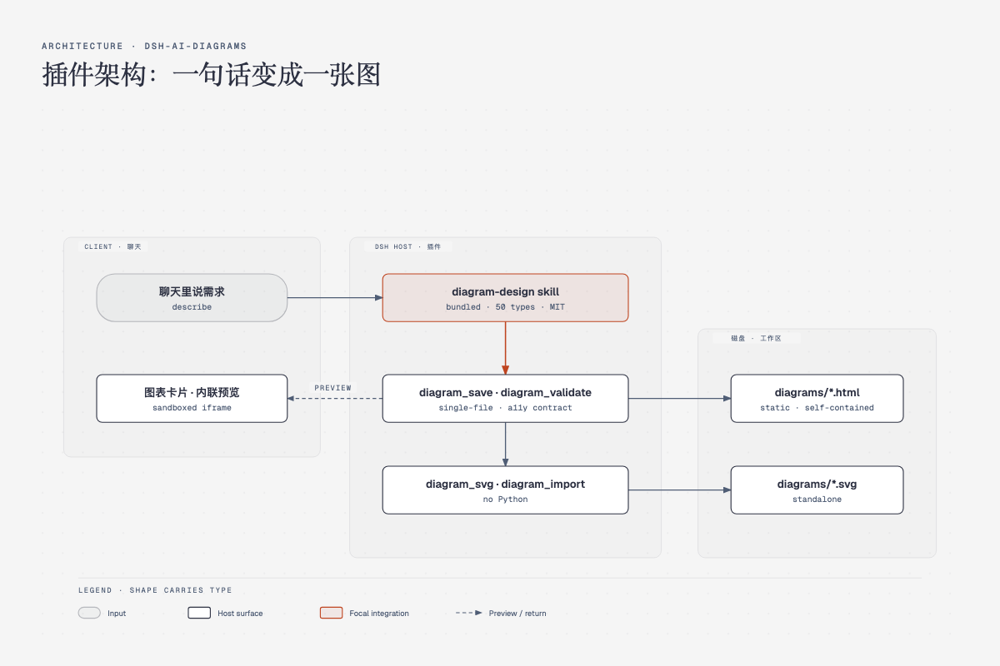

# AI diagrams

[](https://www.npmjs.com/package/dsh-ai-diagrams)
[](./LICENSE)
[](https://github.com/cathrynlavery/diagram-design)

**Editorial diagrams for DeepSeek Harness.** Ask in plain words and the agent draws one self-contained HTML file with inline SVG; it renders directly in the chat, and you can export HTML, SVG or PNG. 50 diagram types, redraws existing draw.io / Mermaid / Excalidraw / PlantUML diagrams, and can match a website's brand.

Built on the MIT-licensed [`cathrynlavery/diagram-design`](https://github.com/cathrynlavery/diagram-design) skill (© Cathryn Lavery), vendored unmodified apart from the DeepSeek Harness tools section.

**Links** — [npm](https://www.npmjs.com/package/dsh-ai-diagrams) · [Marketplace PR](https://github.com/awesome-dsh-plugin/awesome-dsh-plugin/pull/15783) · [Workshop PR](https://github.com/zhu1090093659/dsh-community-plugins/pull/111)



## Install

```sh
dsh plugin add dsh-ai-diagrams
```

Or install from the marketplace / a local checkout.

## Use

Say what you want a diagram of, then publish it:

> 给这个应用的架构画一张图：前端、后端、数据库、Redis 缓存。

> Draw a quadrant of Q2 projects by impact vs effort.

The agent loads the `diagram-design` skill, writes the HTML document, and calls `diagram_save`. The diagram appears inline; the card offers **HTML**, **SVG**, **PNG**, **Open** and a larger preview. Ask for changes and the agent redraws it.

Redraw an existing diagram:

> Redraw platform.drawio for my deck.

The agent calls `diagram_import`, gets a structure digest, picks the matching type, and saves the editorial version.

Match your brand once:

> Onboard diagram-design to https://example.com — use our palette and fonts.

## Tools

| Tool | What it does |
|---|---|
| `diagram_save` | Validate + save a diagram HTML into `diagrams/`; renders the inline card |
| `diagram_svg` | Export the diagram-only `.svg` next to the saved HTML |
| `diagram_validate` | Check the accessible-SVG / single-file contract; returns exact errors |
| `diagram_import` | Extract a bounded structure digest from draw.io / Mermaid / Excalidraw / PlantUML |

## Requirements and limits

- No Python and no Playwright: validation, SVG export, source parsing and PNG rasterization are TypeScript/browser code.
- Saved diagrams are static: no `<script>`, no remote assets except the approved Google Fonts stylesheet. Motion variants are not previewed in DSH.
- PNG is rasterized in the browser at 2×; webfonts fall back to local fonts in the PNG.
- The skill's deep painted-geometry checker (`verify_geometry.py`) is not ported; the DSH validator checks the accessible/SVG contract and single-file safety.

## License

Plugin code: Apache-2.0. Vendored `skills/diagram-design/` is MIT (© Cathryn Lavery); see [`THIRD_PARTY_LICENSES.md`](THIRD_PARTY_LICENSES.md).
